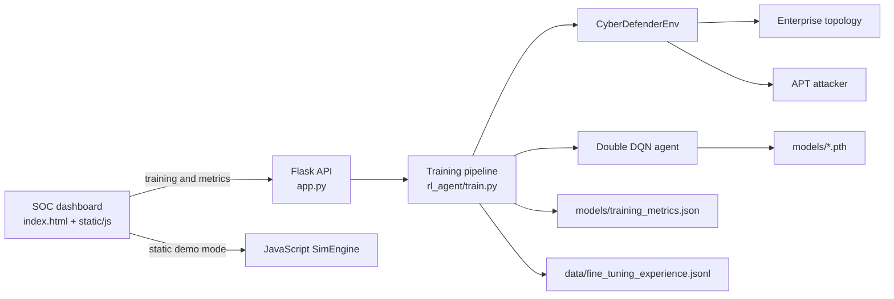

<div align="center">

# 🛡️ Autonomous Enterprise Cyber Defender

### A Cyber Defense Simulation Powered by Double DQN

**Explore a simulated enterprise network, respond to a multi-stage APT, and study how reinforcement learning balances containment with business uptime.**

[](https://www.python.org/)
[](https://pytorch.org/)
[](https://flask.palletsprojects.com/)

<br />

**[Overview](#overview) · [Architecture](#architecture) · [Quick start](#quick-start) · [Training](#training) · [Data](#training-data-and-metrics)**

</div>

---

> [!IMPORTANT]
> This repository is an educational simulation. It does not monitor, protect, or take action on real networks. Its attacker, vulnerabilities, hosts, and telemetry are simulated.

## Overview

Cyber Defender is a small reinforcement-learning testbed with two parts:

1. **Python training system** — a custom enterprise-network environment and a PyTorch Double Deep Q-Network (Double DQN) defender.
2. **SOC web dashboard** — a browser-based interface for visualizing the scenario. It includes a JavaScript simulator for static hosting; that simulator is separate from the Python training environment.

The defender receives a 64-value observation and selects one of 40 actions: four defensive action types applied to one of ten nodes. The simulated attacker attempts reconnaissance, exploitation, credential theft, lateral movement, and database exfiltration.

### Defensive actions

| Action IDs | Action | Purpose |
|---|---|---|
| `0–9` | Isolate host | Quarantine a selected node |
| `10–19` | Re-image host | Restore a compromised node |
| `20–29` | Deploy decoy | Add a honeypot to a selected node |
| `30–39` | Revoke credentials | Remove exposed authentication tokens |

Rewards encourage containment and deception while penalizing unnecessary isolation of clean hosts. Exact transition and reward behavior is defined in [`cyberbattle_env/env.py`](cyberbattle_env/env.py).

## Architecture



### Reinforcement-learning setup

- **Observation:** 64 `float32` features: six features per node across ten nodes, plus four network-wide signals.
- **Action space:** 40 discrete actions (`action_type × 10 + node_id`).
- **Q-network:** `64 → 256 → 128 → 40`, using LeakyReLU hidden layers.
- **Learning:** Double DQN with experience replay, a target network, Huber loss, and soft target updates.
- **Scenario:** Ten nodes spanning perimeter, DMZ, corporate, infrastructure, database, and deception roles.

The Python environment is the source of truth for training. The browser's [`static/js/sim_engine.js`](static/js/sim_engine.js) is a standalone visualization/demo simulator; its heuristic action scores are not the trained PyTorch network's Q-values.

## Quick start

### Requirements

- Python 3.10 or later
- Dependencies from [`requirements.txt`](requirements.txt)
- CPU is sufficient for the small example model; CUDA is used automatically when available

### Windows PowerShell

```powershell
git clone https://github.com/MuhammadAsad29/Autonomous-Enterprise-Cyber-Defender.git
Set-Location Autonomous-Enterprise-Cyber-Defender

py -3 -m venv .venv
.\.venv\Scripts\Activate.ps1
python -m pip install --upgrade pip
pip install -r requirements.txt
python app.py
```

Open [http://localhost:8080](http://localhost:8080). The Flask app serves the dashboard and exposes training and metrics endpoints. The network simulation itself runs in the browser; its step/reset/config API routes are placeholders rather than a bridge to the Python environment.

### Linux or macOS

```bash
git clone https://github.com/MuhammadAsad29/Autonomous-Enterprise-Cyber-Defender.git
cd Autonomous-Enterprise-Cyber-Defender

python3 -m venv .venv
source .venv/bin/activate
python -m pip install --upgrade pip
pip install -r requirements.txt
python app.py
```

Then open [http://localhost:8080](http://localhost:8080).

## Training

Train from the command line:

```bash
# Resume from an available model checkpoint
python -m rl_agent.train --episodes=25

# Start with fresh model weights
python -m rl_agent.train --fresh --episodes=25
```

The dashboard's **Start Fine-Tuning Pass** button sends the selected episode count to `POST /api/train`. When used with the Flask backend, training runs in Python and updates the model checkpoint, metrics, and JSONL log. The request returns after the batch finishes; it is not a streamed, per-step progress feed.

On static hosting (for example GitHub Pages or a static Hugging Face Space), there is no Python backend. The browser simulator can still demonstrate the interface, but it cannot train the PyTorch model or persist training data. Its displayed demo results are not evidence of a backend training run.

### Training outputs

| Path | Purpose |
|---|---|
| [`models/double_dqn_defender.pth`](models/double_dqn_defender.pth) | Model and optimizer checkpoint |
| [`models/replay_buffer.pth`](models/replay_buffer.pth) | Local replay buffer; ignored by Git |
| [`models/training_metrics.json`](models/training_metrics.json) | Episode rewards, win rates, outcomes, and loss history |
| [`data/fine_tuning_experience.jsonl`](data/fine_tuning_experience.jsonl) | Appended per-step training experience and session summaries |

The JSONL entries are generated by this repository's simulated training loop. They are not real incident telemetry. The current converter, [`convert_jsonl.py`](convert_jsonl.py), reconstructs placeholder states because the log does not store full state vectors; converted records should not be treated as exact offline-RL transitions.

## Project layout

```text
cyberbattle_env/
  topology.py              Simulated enterprise network
  attacker.py              APT behavior and attack progression
  env.py                   Observation, defender actions, rewards, termination
rl_agent/
  network.py               PyTorch Q-network
  replay_buffer.py         Experience replay storage
  double_dqn.py            Double DQN action selection and learning
  train.py                 Training, checkpointing, metrics, and JSONL logging
static/
  js/sim_engine.js         Browser-only demo simulation
  js/soc.js                Dashboard behavior and API integration
  css/soc.css              Dashboard styles
models/                    Model checkpoint and generated metrics
data/                      Fine-tuning experience log
tests/                     Python unit and integration tests
app.py                     Flask web app and training/metrics API
api/index.py               Vercel entry point
wsgi.py                    WSGI entry point
```

## Deployment notes

- **Local Flask:** `python app.py` (port `8080`).
- **PythonAnywhere / WSGI:** use [`wsgi.py`](wsgi.py) as the WSGI entry point; see [`PYTHONANYWHERE_DEPLOYMENT.md`](PYTHONANYWHERE_DEPLOYMENT.md).
- **Static hosting:** the repository includes GitHub Pages and Hugging Face sync workflows. Static sites run the browser demo only; Python training requires a Python backend.
- **Docker / Vercel:** deployment configuration is present, but should be validated against each platform before use. For example, the Docker image starts Gunicorn while `gunicorn` is not currently listed in `requirements.txt`.

## Tests

Run the current test suite with:

```bash
python -m unittest discover -s tests -v
```

The tests cover topology, environment transitions, the agent, replay buffer, and Flask routes. Some API assertions may need to be aligned with the currently implemented placeholder endpoints.

## Responsible use

This project is for learning and controlled simulation only. Vulnerability labels and attack narratives describe simulated scenario elements; they are not instructions for assessing or exploiting real systems.

---

<div align="center">

Built by [Muhammad Asad](https://github.com/MuhammadAsad29) · Double DQN · PyTorch · Flask

</div>
