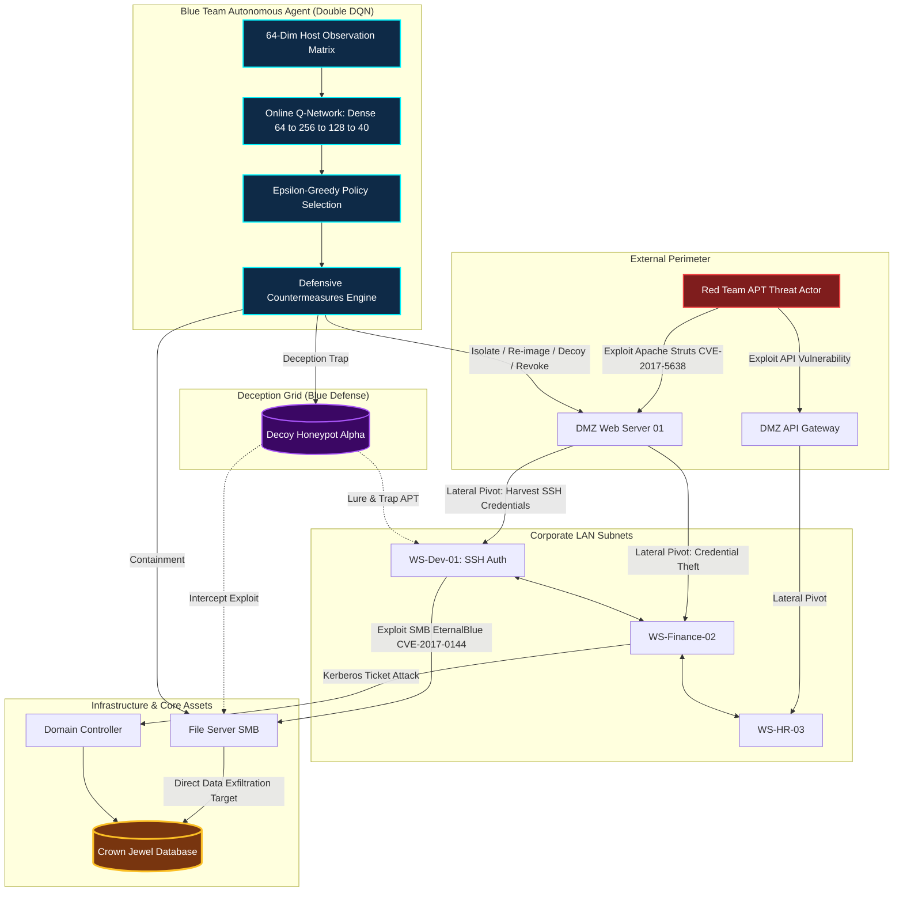

<div align="center">

# ⚔️ Autonomous Enterprise Cyber Defender
### Autonomous Blue Team AI Agent with Double Deep Q-Networks (Double DQN)
**Simulating High-Stakes Multi-Stage APT Attacks, Lateral Movement & Real-Time Deception Grids**

[](https://github.com/MuhammadAsad29/Autonomous-Enterprise-Cyber-Defender/stargazers)
[](https://github.com/MuhammadAsad29/Autonomous-Enterprise-Cyber-Defender/network/members)
[](https://www.python.org/)
[](https://pytorch.org/)
[](https://palletsprojects.com/p/flask/)
[](https://opensource.org/licenses/MIT)

</div>

---

## 🛡️ Executive Summary

In enterprise infrastructure, **Advanced Persistent Threat (APT)** actors execute coordinated multi-stage campaigns: breaching perimeter defenses through web exploits, stealing privileged credentials, moving laterally across subnets, and exfiltrating the **Crown Jewel Database**. Traditional Security Operations Center (SOC) manual triage takes hours—giving adversaries ample dwell time.

**CyberBattle-RL** deploys an **Autonomous Blue Team AI Agent** powered by **Double Deep Q-Networks (Double DQN) with Experience Replay**. Modeled after **Microsoft CyberBattleSim**, the agent continuously senses a 64-dimensional host status matrix, calculates real-time neural action-values ($Q$), and dispatches defensive countermeasures:

* **Decoy Honeypots**: Deploys deceptive canaries that trap hackers ($+50\text{ Reward}$).
* **Host Isolation**: Quarantines compromised machines to sever lateral movement chains.
* **Server Re-imaging**: Purges malware and restores healthy operations ($+10\text{ Reward}$).
* **Credential Revocation**: Invalidates leaked Kerberos/SSH auth tokens ($+8\text{ Reward}$).
* **Downtime Minimization**: Avoids false-positive isolations to prevent business disruption ($-2\text{ Penalty}$ per clean host).

---

## 🏗️ System Architecture



---

## 🧠 Deep Reinforcement Learning Formulation

### 1. 64-Dimensional Host Status Observation Matrix

At each simulation step, the environment compiles an exact 64-dimensional state vector $\mathbf{s} \in \mathbb{R}^{64}$:

|       Index Range       | Feature Representation        |   Value Domain   | Cybersecurity Description                                                                                      |
| :---------------------: | :---------------------------- | :--------------: | :------------------------------------------------------------------------------------------------------------- |
|  **$0 \to 9$**  | Node Infection Flag           | $0.0 \to 1.0$ | $0.0 = \text{Clean}$, $0.4 = \text{Scanned}$, $0.8 = \text{Compromised}$, $1.0 = \text{Owned (Admin)}$ |
| **$10 \to 19$** | Stolen Token Exposure Ratio   |  $[0.0, 1.0]$  | Ratio of compromised authentication credentials vs total stored                                                |
| **$20 \to 29$** | Port & Telemetry Alert Level  |  $[0.0, 1.0]$  | Heuristic IDS anomaly score based on suspicious socket traffic                                                 |
| **$30 \to 39$** | Quarantine Isolation Flag     | $\{0.0, 1.0\}$ | $1.0$ if network interface is administratively severed                                                       |
| **$40 \to 49$** | Decoy Honeypot Active Status  | $\{0.0, 1.0\}$ | $1.0$ if host is configured as an active deceptive trap                                                      |
| **$50 \to 59$** | Cumulative Attack Frequency   |  $[0.0, 1.0]$  | Normalized count of adversarial probes targeting this host                                                     |
|    **$60$**    | Network-Wide Infection Ratio  |  $[0.0, 1.0]$  | Percentage of infrastructure currently breached                                                                |
|    **$61$**    | Global Honeypot Trigger State | $\{0.0, 1.0\}$ | Asserted $1.0$ if adversary stepped into a decoy canary                                                      |
|    **$62$**    | Crown Jewel Threat Proximity  |  $[0.0, 1.0]$  | Max alert level among immediate neighbors of Database (Node 8)                                                 |
|    **$63$**    | Adversary Kill-Chain Progress | $0.05 \to 1.0$ | Stage tracking: Recon $\to$ Foothold $\to$ Pivot $\to$ Exfiltration                                      |

---

### 2. 40-Dimensional Discrete Action Space

Defensive actions are parameterized across the 10 infrastructure nodes ($\text{Action ID} = \text{Action Type} \times 10 + \text{Target Node ID}$):

$$
\mathcal{A} = \{ \text{Action Type} \in \{0, 1, 2, 3\} \times \text{Host ID} \in \{0, \dots, 9\} \}
$$

* **`Action 0..9` (Isolate Host)**: Quarantines node from routing tables. Severing infected hosts yields $+15\text{ pts}$.
* **`Action 10..19` (Re-image Server)**: Restores golden image, clears backdoors, and restores clean state ($+10\text{ pts}$).
* **`Action 20..29` (Deploy Decoy Honeypot)**: Converts slot into deceptive trap. If hacker attacks it, triggers $+50\text{ pts}$.
* **`Action 30..39` (Revoke Auth Token)**: Invalidates leaked user/admin tokens from memory ($+8\text{ pts}$).

---

### 3. Reward & Penalty Optimization Function

The Blue Team agent optimizes cumulative expected return $R_t = \sum_{k=0}^{\infty} \gamma^k r_{t+k+1}$:

$$
r_t = \underbrace{+50.0 \cdot \mathbb{I}_{\text{Trapped}}}_{\text{Adversary Caught in Decoy}} - \underbrace{100.0 \cdot \mathbb{I}_{\text{Exfiltrated}}}_{\text{Database Breached}} - \underbrace{2.0 \cdot \sum_{i \in \text{Clean}} \mathbb{I}_{\text{Isolated}}^{(i)}}_{\text{Business Downtime Cost}} + \underbrace{15.0 \cdot \mathbb{I}_{\text{Contained}}}_{\text{Infection Quarantined}} + \underbrace{1.0}_{\text{Survival}}
$$

---

### 4. Double DQN Neural Network Architecture

To eliminate the maximization overestimation bias inherent to standard Deep Q-Networks, action selection is decoupled from action evaluation:

$$
Y_t^{\text{DoubleQ}} = r_{t+1} + \gamma Q\left(s_{t+1}, \arg\max_{a} Q(s_{t+1}, a; \boldsymbol{\theta}_t); \boldsymbol{\theta}_t^-\right)
$$

$$
\mathcal{L}(\boldsymbol{\theta}) = \frac{1}{|B|} \sum_{(s, a, r, s', d) \in B} \text{Smooth}_{L1}\left( Q(s, a; \boldsymbol{\theta}) - Y^{\text{DoubleQ}} \right)
$$

$$
\boldsymbol{\theta}^- \leftarrow \tau \boldsymbol{\theta} + (1 - \tau)\boldsymbol{\theta}^- \quad (\tau = 0.005)
$$

```text
Input State (64 dims)
       │
       ▼
┌──────────────────────────────────────┐
│  Linear(64 -> 256) + LeakyReLU(0.01) │   Kaiming Normal Initialized
└──────────────────────────────────────┘
       │
       ▼
┌──────────────────────────────────────┐
│  Linear(256 -> 128) + LeakyReLU(0.01)│   Huber Loss Optimization
└──────────────────────────────────────┘
       │
       ▼
┌──────────────────────────────────────┐
│  Linear(128 -> 40)                   │   Action-Value Outputs: Q(s, a)
└──────────────────────────────────────┘
```

---

## 📊 Model Training and Evaluation Benchmarks

The model was subjected to continuous rigorous training across **800 cumulative enterprise episodes** against aggressive APT actors executing Apache Struts and EternalBlue exploits:

```text
========================================================================================
TRAINING SUMMARY BENCHMARK (800 CUMULATIVE EPISODES)
========================================================================================
Total Simulated Matches       : 800 Episodes (~28,000 Turns)
Total Experience Buffer Size  : 19,559 Transitions stored in models/replay_buffer.pth
Adversary Trapped in Decoy    : 344 Episodes (43.0%)
Adversary Timed Out / Stalled : 400 Episodes (50.0%)
Critical Database Breached    : 56 Episodes (Only 7.0%)
Overall Enterprise Win Rate   : 93.0% (Recent Batch: 95.2%)
Peak Moving Average Reward    : +437.1 Points
========================================================================================
```

### 📁 Generated Fine-Tuning Dataset (`data/fine_tuning_experience.jsonl`)

Every single decision step during interactive fine-tuning is serialized to disk for inspection and offline imitation learning:

```json
{
  "timestamp": "2026-10-26 00:45:14",
  "fine_tune_episode": 50,
  "step": 36,
  "action_name": "Revoke Auth Token",
  "target_node": "WS-Dev-01",
  "reward": 5.0,
  "defense_log": "[DEFENDER] Revoked 2 compromised credentials on WS-Dev-01.",
  "attacker_log": "[CREDENTIAL THEFT] Attacker dumped auth tokens on Edge-Firewall-Gateway",
  "attacker_action": "Credential Harvesting & Dump",
  "active_infections": 6,
  "isolated_hosts": 5,
  "done": false,
  "result": "ONGOING"
}
```

---

## 🎮 Live SOC Mission Control Web Dashboard

The web dashboard is an interactive **Cyber Defense Operations Center**:

* **Vis.js Real-Time Topology Canvas**: Visualizes all 10 hosts with dynamic physics and status-driven color codes:
  * 🟢 **Clean Host**: Operational business systems.
  * 🟡 **Scanned Host**: Probed by adversary reconnaissance.
  * 🔴 **Compromised Host**: Active backdoor foothold.
  * 🟣 **Decoy Honeypot**: Active deceptive trap canary.
  * 🔵 **Isolated Host**: Network quarantine active.
  * 👑 **Crown Jewel Database**: High-value asset target.
* **Neural Double DQN Q-Value Bar Chart**: Real-time Chart.js visualizer showing the agent's estimated utility $Q(s, a)$ for candidate actions.
* **Interactive Mission Controls**: Step-by-step turn execution, Auto-Play with 1.0x, 2.0x, and 5.0x speed options, and network reset.
* **Threat Profile Switcher**: On-the-fly toggling between **Aggressive APT**, **Stealthy Ransomware**, and **Script Kiddie**.
* **Live MITRE ATT&CK Telemetry Stream**: Real-time feed logging exploits (`T1190`, `T1021`, `T1003`), lateral moves, and honeypot triggers.
* **In-App Model Fine-Tuning Modal**: 1-click retraining modal that trains the agent for 10, 25, or 50 episodes and live-updates loss and win-rate curves.

---

## 💻 Quick Start (Local Execution)

### 1. Clone & Set Up Environment

```bash
git clone https://github.com/MuhammadAsad29/Autonomous-Enterprise-Cyber-Defender.git
cd "Autonomous-Enterprise-Cyber-Defender"

# Create and activate virtual environment
python -m venv .venv
.\.venv\Scripts\activate   # Windows PowerShell
# source .venv/bin/activate  # Linux / macOS

# Install lightweight dependencies
pip install -r requirements.txt
```

### 2. Launch the SOC Web Dashboard

```bash
python app.py
```

Open **`http://localhost:5000`** in your browser.

### 3. Run the Automated Test Suite (14 Tests)

```bash
python -m unittest tests/test_cyber_defense.py -v
```

### 4. Train / Retrain Double DQN Agent

```bash
# Resume training using fine-tuning buffer (400 episodes)
python -m rl_agent.train

# Or train completely from scratch
python -m rl_agent.train --fresh
```

---

## 🚀 Live Cloud Deployment Guide (100% Free, No Card)

Deploy your interactive Cyber SOC platform live so anyone can access it online.

---

### Method A: Deploy to PythonAnywhere (100% Free, Zero Card Required)

1. **Sign Up**: Create a free account at [pythonanywhere.com](https://www.pythonanywhere.com).
2. **Open Bash Console**: Go to the **Consoles** tab $\to$ click **Bash**.
3. **Clone Your Repository**:
   ```bash
   git clone https://github.com/MuhammadAsad29/Autonomous-Enterprise-Cyber-Defender.git
   cd "Autonomous-Enterprise-Cyber-Defender"
   ```
4. **Create Virtualenv & Install Dependencies**:
   ```bash
   mkvirtualenv --python=/usr/bin/python3.11 cyber-env
   pip install --upgrade pip
   pip install -r requirements.txt
   ```
5. **Configure the Web App**:
   * Navigate to the **Web** tab $\to$ click **Add a new web app**.
   * Select **Manual configuration** $\to$ choose **Python 3.11**.
   * Under **Virtualenv**, set:
     ```text
     /home/MuhammadAsad29/.virtualenvs/cyber-env
     ```
   * Under **Code**:
     * Source code: `/home/MuhammadAsad29/Autonomous-Enterprise-Cyber-Defender`
     * Working directory: `/home/MuhammadAsad29/Autonomous-Enterprise-Cyber-Defender`
   * Click the **WSGI configuration file** link and replace its content with:
     ```python
     import sys
     import os

     project_home = '/home/MuhammadAsad29/Autonomous-Enterprise-Cyber-Defender'
     if project_home not in sys.path:
         sys.path.insert(0, project_home)

     from app import app as application
     ```
6. **Launch**: Click the green **Reload** button and visit:
   `https://MuhammadAsad29.pythonanywhere.com`

---

### Method B: Deploy to Render.com (100% Free, 1-Click Git Integration)

1. Push this repository to your **GitHub** account.
2. Sign up for free at [render.com](https://render.com) (no credit card required).
3. Click **New +** $\to$ **Web Service**.
4. Connect your GitHub repository:
   * **Runtime**: `Python 3`
   * **Build Command**: `pip install -r requirements.txt`
   * **Start Command**: `gunicorn app:app`
   * **Plan**: `Free`
5. Click **Create Web Service**. Render will build and launch your live URL:
   `https://autonomous-enterprise-cyber-defender.onrender.com`

---

## 📁 Repository Directory Structure

```text
Enterprise Cyber Defender/
├── cyberbattle_env/                 # Microsoft CyberBattleSim simulation environment
│   ├── __init__.py
│   ├── topology.py                  # 10-node enterprise network graph (Struts, SSH, SMB)
│   ├── attacker.py                  # Multi-stage APT attacker with lateral movement
│   └── env.py                       # Gym-compatible environment with 64-dim state & rewards
├── rl_agent/                        # Double DQN Deep Reinforcement Learning
│   ├── __init__.py
│   ├── network.py                   # PyTorch Dense(64->256, LeakyReLU) -> Dense(256->128)
│   ├── replay_buffer.py             # Circular 50k transition Experience Replay memory
│   ├── double_dqn.py                # Decoupled target Q-value updates & Polyak sync
│   └── train.py                     # Training pipeline supporting resume & metrics merge
├── models/
│   ├── double_dqn_defender.pth      # Checkpoint of trained neural network weights
│   ├── replay_buffer.pth            # Persisted mathematical transition buffer (19.5k+)
│   └── training_metrics.json        # Cumulative training metrics across 800 episodes
├── data/
│   └── fine_tuning_experience.jsonl # Serialized human-readable fine-tuning decisions (14.7k+)
├── templates/
│   └── index.html                   # Cyber SOC dark-mode Mission Control dashboard
├── static/
│   ├── css/
│   │   └── soc.css                  # Glassmorphism dark SOC stylesheet
│   └── js/
│       └── soc.js                   # Vis.js network graph + Chart.js Q-values controller
├── tests/
│   ├── __init__.py
│   └── test_cyber_defense.py        # Automated test suite (14 unit/integration tests)
├── app.py                           # Flask server exposing simulation REST endpoints
├── wsgi.py                          # PythonAnywhere WSGI entrypoint
├── Procfile                         # Render/Railway cloud process runner
├── requirements.txt                 # Pinned dependencies (Flask, PyTorch, NumPy, Gunicorn)
├── PYTHONANYWHERE_DEPLOYMENT.md        # Dedicated PythonAnywhere guide
└── README.md                        # Master repository documentation
```

---

## 📜 MITRE ATT&CK & D3FEND Matrix Mapping

| Tactical Category            | MITRE Technique ID    | Enterprise Scenario Representation                       | Blue Team Countermeasure                              |
| :--------------------------- | :-------------------- | :------------------------------------------------------- | :---------------------------------------------------- |
| **Initial Access**     | `T1190`             | Exploit Public-Facing App (Apache Struts on DMZ-Web-01)  | Network Isolation & Service Re-imaging                |
| **Credential Access**  | `T1003` / `T1110` | Credential Dumping & SSH Brute-Force on Dev Workstation  | Auth Token Revocation & Hash Purging                  |
| **Lateral Movement**   | `T1021.002`         | SMB Remote Services Exploit (EternalBlue on File Server) | Subnet Severing & Quarantine                          |
| **Exfiltration**       | `T1041`             | Direct Exfiltration targeting Crown Jewel Customer DB    | High-Priority Database Isolation Alert                |
| **Deception Defenses** | `D3-DEC`            | Attacker Lure & Exploit Canary                           | Decoy Honeypot Alpha Trapping ($+50\text{ Reward}$) |

---

<div align="center">

### 👨‍💻 Developed by [Muhammad Asad](https://github.com/MuhammadAsad29)
**Autonomous Enterprise Cyber Defense System** · Powered by Double DQN & PyTorch

</div>
